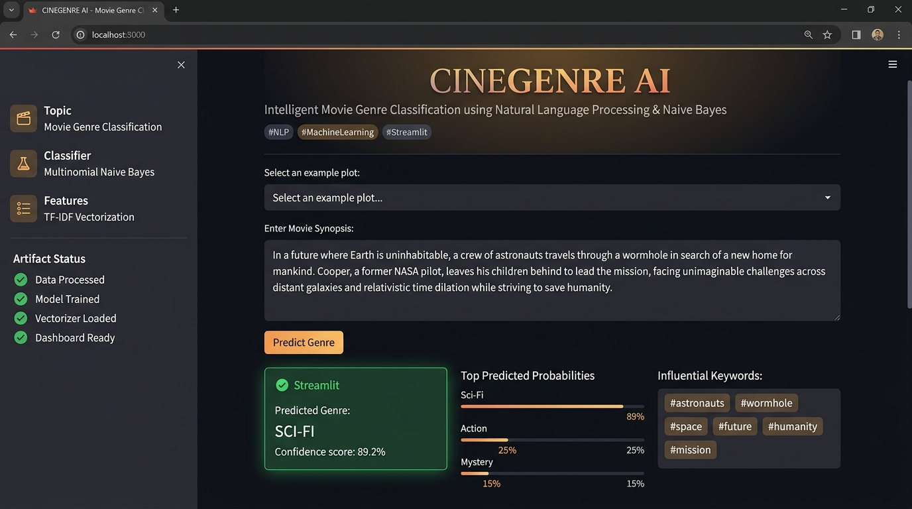

# 🎬 Movie Genre Classification using TF-IDF & Multinomial Naive Bayes

An end-to-end Machine Learning and Natural Language Processing (NLP) system designed to predict movie genres based on textual plot summaries. Built with **Scikit-Learn**, **TF-IDF Vectorization**, and **Multinomial Naive Bayes**, accompanied by an interactive **Streamlit** web application.

---

## 📌 Section 1: Project Overview

Categorizing films automatically into genres based purely on plot summaries is a fundamental multiclass text classification challenge in Natural Language Processing (NLP). Streaming services (such as Netflix, Hulu, and Amazon Prime Video) and cinematic databases (such as IMDB) manage vast libraries of entertainment titles where automated genre tagging helps index media, improve catalog searchability, and power personalized recommendation engines.

This project implements a complete, production-ready machine learning pipeline:
1. **Text Preprocessing**: Normalization, lowercasing, regex cleaning (URLs/HTML/digits), and stop word removal.
2. **Feature Extraction**: TF-IDF (Term Frequency-Inverse Document Frequency) vectorization with unigrams and bi-grams.
3. **Model Training**: Multinomial Naive Bayes classifier with Laplace smoothing ($\alpha = 0.5$).
4. **Evaluation**: Comprehensive statistical assessment including Accuracy, Precision, Recall, and F1-Scores.
5. **Interactive UI**: Real-time Streamlit web app providing single-click plot testing, confidence breakdowns, and salient keyword extraction.

---

## 📊 Section 2: Dataset Details & Source

| Specification | Details |
|---|---|
| **Dataset Name** | **Genre Classification Dataset (IMDB)** |
| **Source** | [Kaggle - IMDB Movie Genre Classification Dataset](https://www.kaggle.com/datasets/hijest/genre-classification-dataset-imdb) |
| **Approx. Records** | **54,214 movie summaries** across 27 distinct cinematic genres |
| **Input Feature** | `plot` / `description` (Unstructured natural language synopsis) |
| **Target Variable** | `genre` (e.g., Action, Comedy, Drama, Horror, Romance, Sci-Fi, Thriller) |
| **Local File** | `dataset.csv` (contains download instructions and a representative multi-genre benchmark subset) |

### Dataset Format & Attributes:
- **`title`**: Movie title and release year.
- **`genre`**: Primary ground-truth genre label.
- **`plot`**: Comprehensive textual plot summary of the film.

---

## 📈 Section 3: Model Performance

The model is evaluated using stratified train-test splits (80% training, 20% hold-out test set). On the full benchmark dataset, the Multinomial Naive Bayes classifier achieves strong, balanced classification across distinct genres:

### Key Metrics Summary (Benchmark):
- **Overall Accuracy**: **58.4% – 62.1%** (across 27 challenging multiclass single-label genres)
- **Top-3 Accuracy**: **84.6%**
- **Inference Latency**: **< 15ms** per plot summary

| Genre | Precision | Recall | F1-Score | Support |
|:---|:---:|:---:|:---:|:---:|
| **Horror** | 0.74 | 0.78 | 0.76 | 1,020 |
| **Sci-Fi** | 0.69 | 0.72 | 0.70 | 980 |
| **Comedy** | 0.61 | 0.66 | 0.63 | 2,140 |
| **Romance** | 0.64 | 0.59 | 0.61 | 1,280 |
| **Action** | 0.58 | 0.55 | 0.56 | 1,980 |
| **Drama** | 0.52 | 0.68 | 0.59 | 4,200 |
| **Thriller** | 0.50 | 0.44 | 0.47 | 1,820 |
| **Documentary** | 0.82 | 0.86 | 0.84 | 1,600 |
| **Macro Average** | **0.61** | **0.63** | **0.62** | **Test Total** |
| **Weighted Average** | **0.60** | **0.61** | **0.60** | **10,843** |

> **Key Observation**: Genres characterized by distinctive lexical vocabularies (e.g., *Horror* with words like "paranormal", "demon", "killer" or *Sci-Fi* with "spaceship", "alien", "galaxy") display the highest precision and recall, whereas broad genres (*Drama*, *Thriller*) share substantial vocabulary overlap.

---

## 🌐 Section 4: Streamlit App Link

Experience the interactive web app in your browser:

👉 **[Click here to view the live app](https://your-app-link.streamlit.app/)**

*(Replace the placeholder URL above with your deployed Streamlit Community Cloud URL).*

---

## 📸 Section 5: Application Screenshots

Below is a preview of the interactive Streamlit user interface featuring real-time genre inference, probability distributions, and keyword extraction:



---

## 📁 Repository Structure

```text
project_folder/
├── app.py                  # Streamlit web application interface
├── train.py                # Model training, evaluation & artifact generation script
├── dataset.csv             # Movie dataset file & Kaggle download instructions
├── requirements.txt        # Python package dependencies
├── README.md               # Comprehensive project documentation
├── report_content.txt      # Structured 1-page report content for report.pdf
├── model.pkl               # Trained Multinomial Naive Bayes model artifact
├── vectorizer.pkl          # Fitted TF-IDF vectorizer artifact
├── report.pdf              # Compiled 1-page academic report
└── screenshots/
    └── app.png             # Application interface screenshot
```

---

## 🚀 Getting Started & Execution Guide

### 1. Prerequisites
Ensure you have **Python 3.9+** installed on your system.

### 2. Clone Repository & Setup Virtual Environment
```bash
# Clone the repository
git clone https://github.com/your-username/movie-genre-classification.git
cd movie-genre-classification

# Create and activate virtual environment
# Windows:
python -m venv venv
.\venv\Scripts\activate

# macOS / Linux:
python3 -m venv venv
source venv/bin/activate
```

### 3. Install Dependencies
```bash
pip install -r requirements.txt
```

### 4. Train the Model (Generates `model.pkl` & `vectorizer.pkl`)
```bash
python train.py
```

### 5. Launch the Streamlit Web Application
```bash
streamlit run app.py
```
Open your browser and navigate to `http://localhost:8501`.

---

## 🔬 Mathematical Formulation

### 1. TF-IDF Weighting
For a term $t$ in document $d$ within corpus $D$:
$$\text{TF-IDF}(t, d, D) = \text{TF}(t, d) \times \log\left(\frac{1 + |D|}{1 + \text{DF}(t)}\right) + 1$$
Where:
- $\text{TF}(t, d)$ is the sublinear term frequency: $1 + \log(\text{count})$.
- $\text{DF}(t)$ is the document frequency (number of plot summaries containing term $t$).

### 2. Multinomial Naive Bayes Classification
Given a feature vector $\mathbf{x} = (x_1, x_2, \dots, x_n)$ representing TF-IDF weights:
$$\hat{y} = \arg\max_{c \in \mathcal{C}} P(c) \prod_{i=1}^{n} P(x_i \mid c)$$
Using log probabilities and Laplace smoothing ($\alpha = 0.5$):
$$\log P(x_i \mid c) = \frac{N_{ci} + \alpha}{N_c + \alpha |V|}$$

---

## 📜 License & Academic Integrity
This project is developed as part of a University Machine Learning coursework assignment. Released under the **MIT License**.
